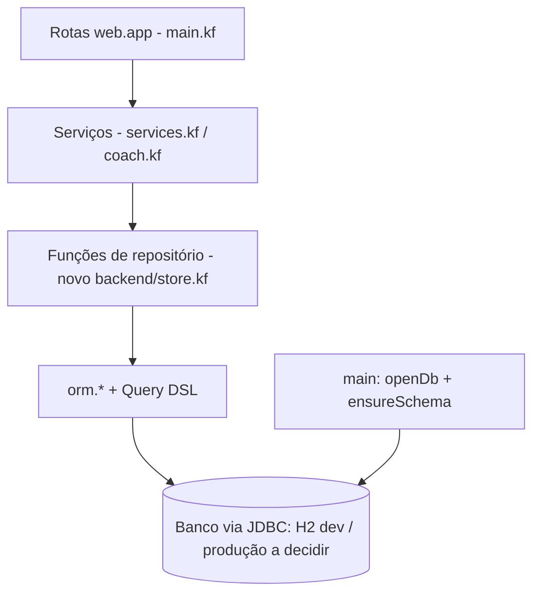

# Persistência com kof.orm — Design

**Spec**: `.specs/features/persistence-kof-orm/spec.md`
**Status**: Draft (aguarda aprovação) · **Kof medido:** 0.6.3 · **Decisões ativas respeitadas:** AD-001 (monólito KofLith)

Toda afirmação de API abaixo tem fonte (Kof4j `4db805c` = tag 0.6.3) ou medição (repros fora do repo,
saídas no relatório da sessão de 12/10/2026).

---

## Architecture Overview



Abordagens avaliadas (mesmo escopo):

| # | Abordagem | Prós | Contras | Veredito |
|---|---|---|---|---|
| A | **`entity` + `orm.*` + Query DSL**, um arquivo de repositório | Sem SQL escrito à mão; binds automáticos; DDL gerado; medido de ponta a ponta | Entity é record imutável; sem enum/FK/índice; >4 binds na DSL dá ORM004 | **Recomendada** |
| B | `db.execute/query<T>` com SQL manual | Controle total (índices, FK, tipos) | Máx. 4 binds por chamada (`KofDb.MAX_BIND`) — insert de transação tem 9 colunas; mais superfície de injeção | Só para migrações (`orm.migrate`) |
| C | Manter listas + dump JSON em arquivo | Simples | Sem concorrência, sem transação, reescreve tudo a cada gravação | Rejeitada |

## Code Reuse Analysis

| Existente | Local | Uso |
|---|---|---|
| Funções de repositório com assinatura estável (`findUserById`, `saveTransaction`, …) | `backend/services.kf:78-310`, `coach.kf:68-89` | Mesmas assinaturas; só o corpo troca de lista para `orm.*` — rotas e serviços quase não mudam |
| `currentUserId()` | `backend/auth.kf:90` | Fonte única do `userId` em todo filtro (PERS-09) |
| `config.str/required` | `backend/auth.kf:11` | `KOF_DB_URL` via `config.str("db.url", ...)` (mesmo mapeamento de `jwt.secret`→`KOF_JWT_SECRET`, medido) |
| Contornos `orZero`, enum como String | `models.kf:89`, `services.kf:57` | Continuam (bugs presentes no 0.6.3) |
| E2E + harnesses | `scripts/test_e2e_flow.ps1`, scratchpad `tools/` | Base do G-E2E; G-RESTART é um bloco novo |

## Components

### Store (`backend/store.kf`, novo)
- **Purpose**: único lugar com `entity` e acesso a banco.
- **Interfaces**: `String openDb()` (lê `KOF_DB_URL`, conecta, `ensureSchema`); as funções de repositório atuais com o mesmo nome/assinatura, devolvendo os tipos de domínio.
- **Dependencies**: `kof.db`, `kof.orm`, `config`.
- **Reuses**: assinaturas de `services.kf`/`coach.kf`.

### Mapeamento entity ↔ domínio
Entities são records imutáveis (SEM038, medido orm2d) e não aceitam enum (medido orm2a). Os tipos de domínio
mutáveis de `models.kf` continuam sendo o que serviços e rotas usam; o Store converte nas duas direções
(`toRow`/`fromRow`). Atualização = construir a row nova com o mesmo `id` e `orm.save` (upsert por PK, medido orm2c).

## Data Models

Tabela = nome da entity em minúsculas (`KofOrm.tableName`). Colunas camelCase funcionam no JVM (§564, medido orm2c),
mas SQL cru precisa de aspas (`"userEntity"`, `"userId"`) no H2/Postgres (medido orm2b).

```kof
entity UserRow {
    id: Long generated
    email: String unique
    passwordHash: String
    role: String
    salaryCents: Long
    hasSalary: Bool
    tier: String
    hasVariableIncome: Bool
    emergencyGoalCents: Long
    hasEmergencyGoal: Bool
    budgetModel: String
    incomeType: String
    hasDebt: Bool
    debtCents: Long
}
entity TransactionRow {
    id: Long generated
    userId: Long
    description: String
    amountCents: Long
    category: String
    currency: String
    bucket: String
    source: String
    createdAt: String
    envelopeId: Long
}
entity EnvelopeRow { id: Long generated; userId: Long; categoryName: String; limitCents: Long; spentCents: Long; limitType: String; movingAverageMonths: Int; createdAt: String }
entity ChatMessageRow { id: Long generated; userId: Long; role: String; content: String; createdAt: String }
entity VariableIncomeRow { id: Long generated; userId: Long; amountCents: Long; source: String; destination: String; date: String }
entity KakeiboReflectionRow { id: Long generated; userId: Long; weekStart: String; answersJson: String; createdAt: String }
```

(Bloco ilustrativo do schema, não código a aplicar; a sintaxe `;` em uma linha precisa ser medida na tarefa — o training
usa as duas formas em `idioms/architecture.md`, só a forma multilinha foi medida.)

- `T?` numérico vira par valor + flag (`Double?` é gravado como VARCHAR, medido orm2b). `createdAt`/`envelopeId` ausentes: `""`/`0` até a #44 definir datas.
- `List<String> answers` → `answersJson` (`json.encode`/`json.decode<List<String>>`).
- Dinheiro em centavos (`Long`): soma exata (`training/language/types.md` "Long arithmetic"); conversão na borda `Double`→centavos com `math.roundTo(math.roundTo(v * 100.0, 6), 0) as Long` (medido no 0.6.3, ver PERS-19).

## Decisão de banco por ambiente

| Ambiente | Opção | Medido? | Trade-off |
|---|---|---|---|
| Dev local | H2 arquivo `jdbc:h2:file:./data/organiza;WRITE_DELAY=0` | ✅ CRUD + persistência entre processos | Zero instalação; arquivo fora do Git (`data/` no `.gitignore`) |
| E2E / CI | H2 memória `jdbc:h2:mem:e2e;DB_CLOSE_DELAY=-1` + G-RESTART com H2 arquivo temporário | ✅ | Rápido; não testa o dialeto de produção |
| Alternativa local | SQLite arquivo | ✅ (aviso de acesso nativo no JDK 25 → `--enable-native-access=ALL-UNNAMED`) | Um arquivo; driver nativo |
| Produção (Render) | **Postgres gerenciado** (`postgres://` → `jdbc:postgresql:` normalizado) | ⚠️ só driver + normalização (conexão recusada em porta fechada); CRUD **não medido** | Banco fora do container sobrevive a redeploy; exige criar banco (ok da Luiza) |
| Produção (Render) | MySQL Aiven (`mysql://` → MariaDB driver) | ⚠️ idem; `jdbc:mysql://` (formato do `.env.example`) dá **DB001** | Reaproveita conta existente; TLS/params Aiven não medidos |
| Produção (Render) | SQLite/H2 em disco persistente do Render | ❌ | Filesystem do container é efêmero; disco persistente depende de plano pago (**não verificado nesta sessão**) |

**Recomendação:** H2 em dev/teste agora (desbloqueia todas as tarefas locais) e Postgres gerenciado em produção,
condicionado a medir CRUD + G-RESTART contra um Postgres real antes do deploy. Escolha final = Luiza.

## Build e deploy (medido)

- O `kof build` **não** copia o driver JDBC; `java -cp classes Default.Main` dá `DB001` (medido db1L).
- Auto-provisionamento só ocorre com URL literal em `db.connect` (DbDriversTest `scanFindsConnectLiteralsIgnoresDynamic`); com URL vinda de config, nem `kofdeps` nem modo diretório resolvem (medido).
- Rota que funcionou: `kof deps resolve` (kofdeps com o driver fixado) → `kof build backend --target jvm --fat --classpath <cp>` → `java -jar kof-app.jar` (medido fatcp). O Dockerfile muda o run stage para isso. `mvn` ausente = dependências transitivas não resolvidas (aviso medido); os drivers usados não têm transitivas obrigatórias no caminho medido.

## Error Handling Strategy

| Cenário | Tratamento | Usuária vê |
|---|---|---|
| E-mail duplicado | `findUserByEmail` antes do save → 409 | 409 (como hoje) |
| Erro de SQL em rota | Exceção Java escapa de `catch (String e)` (medido orm2f) e o kof.web responde 500 (medido web1) | 500 sem detalhe; servidor segue |
| Banco indisponível no boot | `openDb` sem try → processo sai ≠ 0; log sem credenciais (`secrets.redact`) | Render reinicia |
| Enum inválido lido do banco | `valueOf` → null → fallback documentado (ex.: `OTHER`) | dado preservado |

## Plano de migração BackendDb → orm (tarefas atômicas)

Cada tarefa = 1 commit; gate de toda tarefa: **G-BUILD**, **G-BYTECODE** (VerifyAll + LinkAll, z1 acusando), **G-E2E** (36/37); a partir da T3, também **G-RESTART**.

| T | Mudança | Gate extra |
|---|---|---|
| T0 | Fixar o Kof do projeto (Dockerfile `KOF_TAG`, CI) — decisão pendente | CI verde com o tag |
| T1 | `store.kf`: `openDb` + `ensureSchema` (H2 por padrão), sem mudar rotas | boot com e sem `KOF_DB_URL` |
| T2 | Usuários (`UserRow`, register/login/onboarding, ids do banco) | PERS-01, 06, 12, 20 |
| T3 | Bloco G-RESTART no E2E (script novo ou parâmetro) | PERS-01..03 |
| T4 | Envelopes | PERS-03, 09–11 |
| T5 | Transações (centavos na borda) | PERS-15, 17–19 |
| T6 | Chat + renda variável + kakeibo | PERS-07, 10 |
| T7 | Remover `BackendDb`; grep de `size + 1` e de SQL concatenado | PERS-08, 14, 16 |
| T8 | Dockerfile/CI com `--fat --classpath`; `.gitignore` de `data/`; docs (DEPLOY, README, .env.example) | build de container (exige Docker: ok) |
| T9 | Produção: medir o banco escolhido (exige credencial: ok) | G-RESTART contra o banco real |

## Risks & Concerns

| Concern | Location | Impact | Mitigation |
|---|---|---|---|
| Bug #41 vivo no 0.6.3 (z1, z6, m1–m3, z7) e face nova z8c (if-expr em local) | `models.kf:89` | VerifyError tardio | Manter `orZero`; G-BYTECODE em toda tarefa; não usar if-expressão em local com `T?` |
| Enum em entity quebra | entities | 500 em todo save | Colunas String (decidido) |
| Erros de banco não capturáveis por `catch (String e)` | todas as rotas | 500 genérico | Checar antes de gravar; aceitar 500 |
| #44 (datas) | `services.kf:516`, `main.kf:130,140,196,204` | `createdAt` persistido fixo/vazio | Colunas existem; #44 preenche com `time.todayIso()` depois; teste 28 segue vermelho |
| #41 (orZero) | `models.kf:89` | Sem impacto no schema (pares valor+flag eliminam `Double?` no banco) | — |
| Release diário do Kof | Dockerfile, `kof-check.yml` | Build não reproduzível; filtro aceita prerelease | Fixar `KOF_TAG` (T0) e excluir `prerelease` no jq |
| `jdbc:mysql://` no `.env.example` | `.env.example:24` | DB001 se reaproveitado | Documentar `mysql://` / `postgres://` |
| Sem índices além de PK/unique | entities | Filtro por `userId` faz scan | Aceitável no MVP; `orm.migrate(db, "idx-...", "CREATE INDEX ...")` depois |
| H2 em arquivo perde gravações com kill abrupto até ~1 s após escrever (medido na T1: tabelas sumiram) | `backend/store.kf` (URL padrão) | G-RESTART falso verde/vermelho; perda de dados em dev | `;WRITE_DELAY=0` na URL padrão (medido: durável com kill imediato); o G-RESTART mata o processo à força, sem shutdown gracioso |
| Transação usa a última conexão aberta | `transaction {}` | Ambiguidade se houver 2 conexões | Uma conexão por processo |

## Tech Decisions

| Decisão | Escolha | Razão |
|---|---|---|
| Camada | Repositório em `store.kf` com as assinaturas atuais | Menor diff; serviços intactos |
| Entity separada do domínio | `*Row` imutável + conversão | Entity não aceita enum nem mutação |
| Ids na API | String do Long gerado | Contrato JSON inalterado no tipo |
