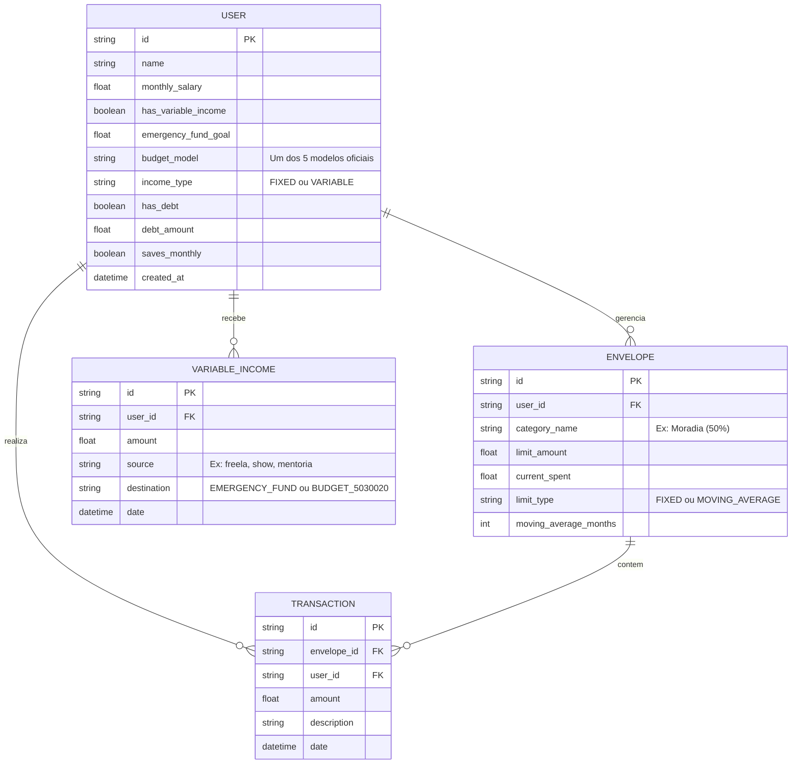
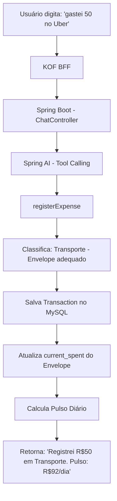
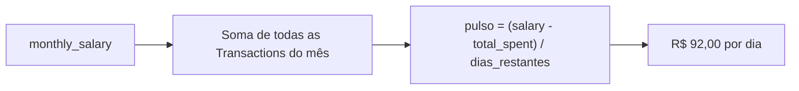
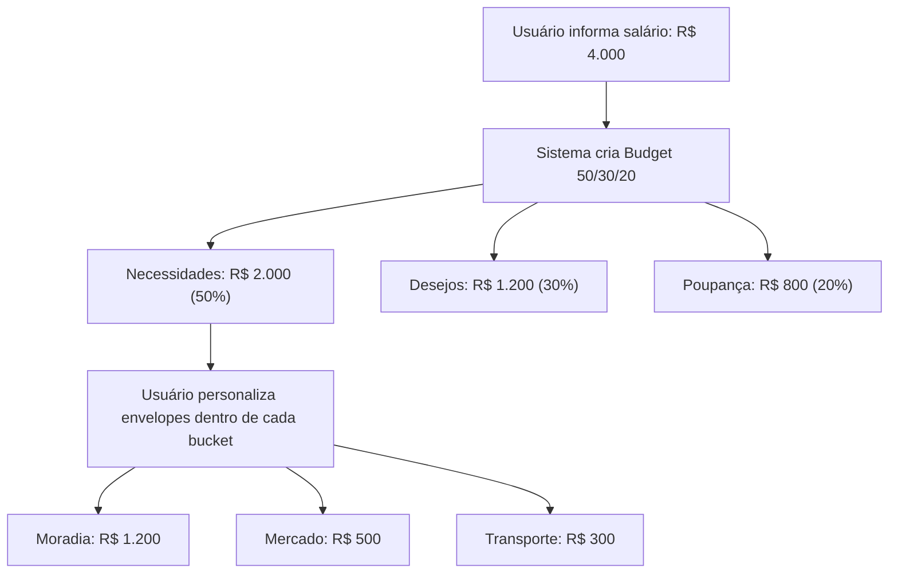
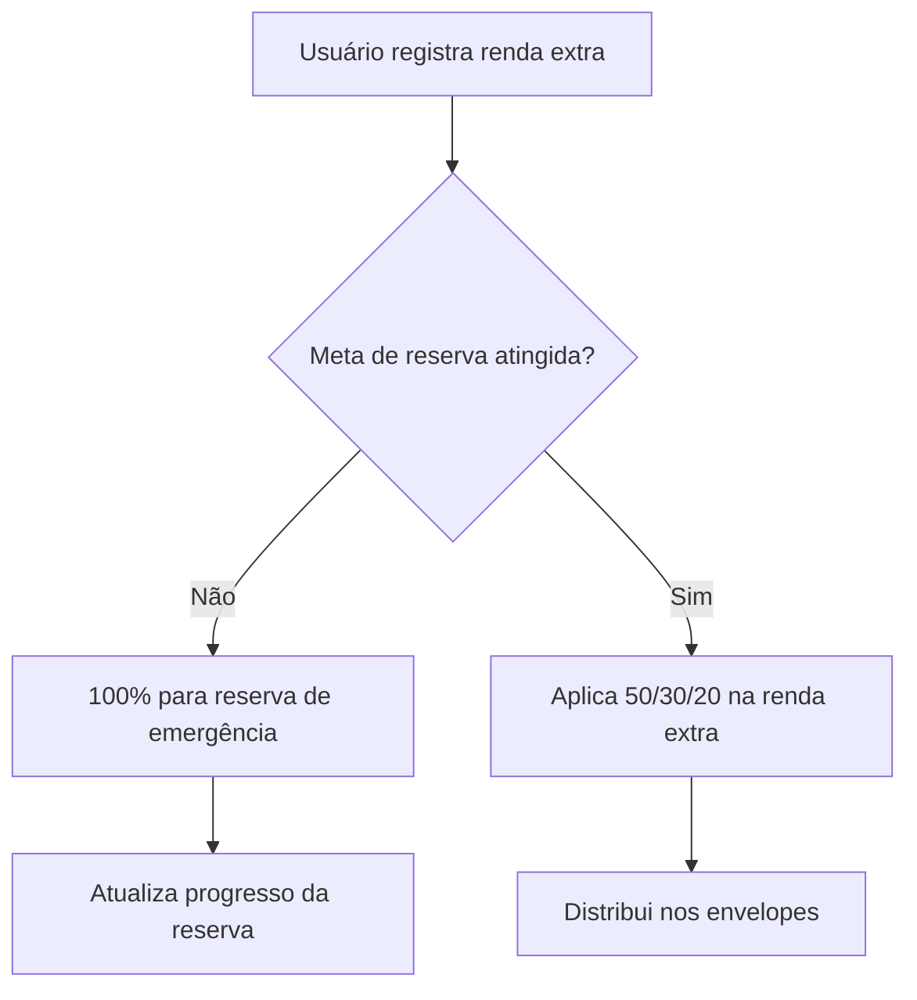
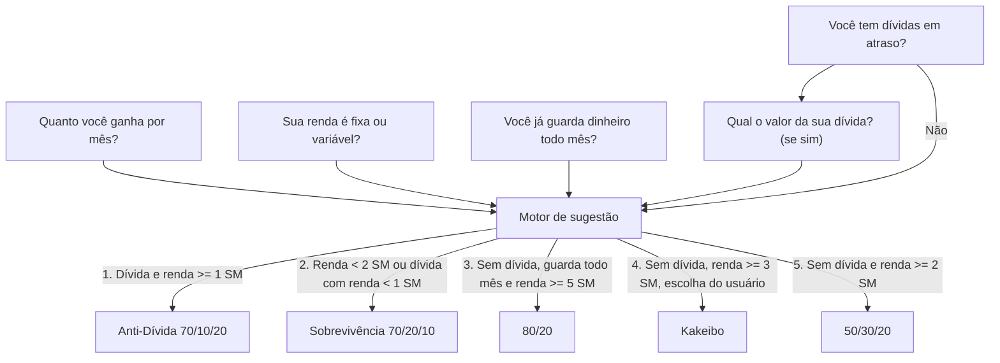

# Modelagem de Dados -- Organiza IA

## Decisões de simplificação

O modelo foi desenhado para facilitar a adoção pelo KOF e permitir que qualquer contribuidor entenda visualmente como os dados se relacionam no banco hospedado no Render.

Três entidades cobrem todo o domínio:

- **USER** é o centro. Tem salário mensal, que é a base de cálculo para tudo.
- **ENVELOPE** pertence ao User e representa um teto de gastos por categoria (ex: "Moradia -- 50%"). O campo `current_spent` é desnormalizado propositadamente para consulta rápida sem precisar agregar transações a cada request.
- **TRANSACTION** pertence ao User e opcionalmente a um Envelope. É o registro de cada gasto ou receita.

A simplicidade é intencional: um dev que olha o diagrama entende o sistema inteiro em 30 segundos.

---

## ER Diagram

---

## Fluxo principal: registro de gasto via chat

## Fluxo: cálculo do pulso diário

## Fluxo: criação automática de envelopes

## Fluxo: renda variável

## Fluxo: onboarding com sugestão de modelo

## Modelos de orçamento adaptativos

SM = salário mínimo (R$ 1.621,00). A coluna `budget_model` só aceita estes 5 valores; valores fora desses 5 são convertidos ao carregar (`userFromRow` em `backend/store.kf`).

| Ordem | Modelo | Renda mínima | Condição | Por quê |
|---|---|---|---|---|
| 1 | **Anti-Dívida 70/10/20 (ANTI_DEBT_701020)** | 1 SM (R$ 1.621) | Tem dívida | Abaixo disso, 20% para quitação não cobre nem a parcela mínima. Quem tem dívida e ganha menos de 1 SM fica no Sobrevivência, e o coach orienta a renegociar. |
| 2 | **Sobrevivência 70/20/10 (SURVIVAL_702010)** | Nenhuma | Renda abaixo de 2 SM (R$ 3.242) | É o modelo de entrada. |
| 3 | **80/20 (SIMPLE_8020)** | 5 SM (R$ 8.105) | Sem dívida e já guarda todo mês | Com 80% livre e sem divisão interna, precisa de folga para não estourar o essencial. |
| 4 | **Kakeibo (KAKEIBO)** | 3 SM (R$ 4.863) | Sem dívida, escolhido pelo usuário | Ele não tem bucket de poupança, então exige margem. |
| 5 | **50/30/20 (STANDARD_503020)** | 2 SM (R$ 3.242) | Sem dívida | |
